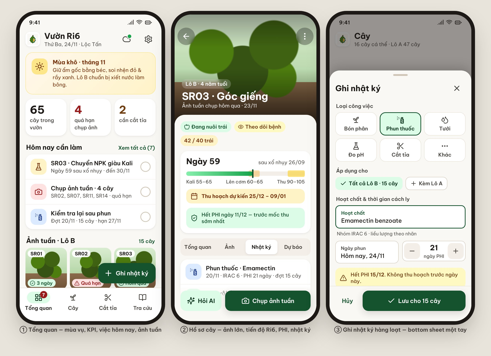

# HỆ THỐNG THIẾT KẾ — Sổ Tay Vườn Ri6

| Mục | Giá trị |
|---|---|
| Phiên bản | 1.0 — 24/11/2026 |
| Soạn | Claude (QA/phản biện) theo yêu cầu chủ vườn: "giao diện thật đẹp, hiện đại, độ phân giải cao, như app thật" |
| Duyệt | Gemini |
| Áp dụng | Task **D01** (dựng hệ thống) và **mọi màn hình** từ T02 trở đi |
| Hình mẫu | [`docs/design/mockup.jpg`](design/mockup.jpg), mở [`mockup.html`](design/mockup.html) để soi chi tiết |

## 1. Nguyên tắc

1. **Ảnh cây là nhân vật chính.** Danh sách, lưới và hồ sơ đều lấy ảnh thật của cây làm trung tâm; chữ và số đi kèm.
2. **Một tay, ngoài nắng.**
   - Vùng bấm ≥ 48 px; nút chính cao 56 px và nằm trong tầm ngón cái (nửa dưới màn hình).
   - Chữ thân 16 px với độ tương phản **≥ 7:1 (AAA)**; chữ phụ ≥ 14 px với độ tương phản ≥ 4,5:1.
3. **Mỗi màn một hành động chính** (FAB hoặc nút 56 px). Các hành động phụ để trong menu hoặc chip.
4. **Nhất quán tuyệt đối.**
   - Màn hình chỉ được dùng component trong `src/components/ui/`.
   - Không viết mã màu hex, `px` hay `shadow` tùy hứng ngoài token. QA sẽ grep để kiểm.
5. **Chuyển động có mục đích**: ngắn, mượt, và tắt được khi người dùng bật giảm chuyển động.
6. **Phong cách Material 3 (Android).** Người dùng chính dùng Android, nên app nên quen tay như app Google.

## 2. Token

Khai báo token bằng CSS variables trong `@theme` của Tailwind v4, đặt tên **theo vai trò** (ví dụ `primary`), không đặt theo màu (ví dụ `green-900`).

### 2.1 Màu (chỉ giao diện sáng; tương phản đã đo)

| Vai trò | Màu chữ | Màu nền | Tương phản |
|---|---|---|---|
| Chữ chính | `--text #1c1917` | `--bg #faf8f5` | 16,5 : 1 |
| Chữ phụ | `--text-2 #44403c` | `--bg` | 9,7 : 1 |
| Chữ meta (thấp nhất cho phép) | `--text-3 #57534e` | `--bg` | 7,2 : 1 |
| Nút chính | `--on-primary #fff` | `--primary #14532d` | 9,1 : 1 |
| Vùng chính nhạt | `--on-pc #052e16` | `--pc #dcfce7` | 13,6 : 1 |
| Nhấn (đỏ bazan) | `#fff` | `--sec #9a3412` | 7,3 : 1 |
| Cơm Ri6 (mốc thu hoạch) | `--on-tc #78350f` | `--tc #fef3c7` | 8,2 : 1 |
| Trạng thái tốt | `--ok #14532d` | `--ok-c #dcfce7` | 8,3 : 1 |
| Sắp đến hạn | `--warn #713f12` | `--warn-c #fef9c3` | 8,1 : 1 |
| Quá hạn / lỗi | `--danger #991b1b` | `--danger-c #fee2e2` | 6,8 : 1 |
| Thông tin / phun thuốc | `--info #1e3a8a` | `--info-c #dbeafe` | 8,5 : 1 |
| Đo pH | `--ph #5b21b6` | `--ph-c #ede9fe` | 7,6 : 1 |
| Tưới | `--water #075985` | `--water-c #e0f2fe` | 6,6 : 1 |

- **Bề mặt:** `--surface #fff` (thẻ), `--s2 #f3efe8` (nền phụ), `--outline #e7e0d4`, `--outline-2 #cfc6b8` (viền ô nhập).
- **Cấm** dùng màu xám nhạt hơn `#57534e` cho chữ. Ví dụ `#78716c` chỉ đạt 4,5 : 1 và nhòe ngoài nắng.
- **Màu theo loại nhật ký** (ô icon 40–44 px):

| Loại | Màu |
|---|---|
| Bón phân | `ok` |
| Phun thuốc | `info` |
| Tưới | `water` |
| Đo pH | `ph` |
| Cắt tỉa | `sec` |
| Sâu bệnh | `danger` |
| Làm bông | `tc` |
| Ghi chú AI | `#3730a3` trên nền `#e0e7ff` |

### 2.2 Chữ
**Font: Be Vietnam Pro** (giấy phép OFL, thiết kế cho tiếng Việt, dấu rõ).
- Tự host bằng `@fontsource/be-vietnam-pro`, chỉ nhúng subset `vietnamese` + `latin`, các độ đậm 400/500/600/700, `font-display: swap`.
- **Không dùng CDN**, để chạy được offline.

| Cấp | Cỡ / dòng | Độ đậm | Dùng cho |
|---|---|---|---|
| display | 28 / 34 | 700, `-0.01em` | Tiêu đề hồ sơ trên ảnh lớn |
| headline | 22 / 28 | 700 | Tiêu đề màn, tiêu đề sheet |
| title | 18 / 24 | 700 | Tiêu đề mục |
| body | 16 / 24 | 400–600 | Nội dung, dòng danh sách |
| label | 14 / 20 | 600 | Nhãn, chip, thanh tab dưới |
| caption | 14 / 20 | 400–500 | Dòng phụ. **Không có cỡ nào dưới 14 px**, trừ huy hiệu số 12 px |
| kpi | 30 / 36 | 700, `-0.02em` | Số lớn |

Mọi con số và ngày tháng dùng `font-variant-numeric: tabular-nums`.

### 2.3 Khoảng cách, bo góc, đổ bóng, chuyển động
- **Khoảng cách:** lưới 4 px (4/8/12/16/20/24/32). Lề màn 16 px (24 px khi ≥ 600 px). Khe giữa thẻ 10–12 px.
- **Bo góc:** ô nhập 12 · chip và nút 12–16 · ảnh 16 · thẻ 20 · mép trên sheet 28 · pill 999.
- **Đổ bóng:**
  - `e1` (thẻ): `0 1px 2px rgb(28 25 23/.06), 0 2px 8px rgb(28 25 23/.05)`.
  - `e2` (FAB, nút chính, sheet): `0 6px 20px rgb(28 25 23/.16)`.
  - Thẻ dùng nền trắng + `e1`, **không** dùng viền đậm.
- **Chuyển động:**
  - Thời lượng: nhấn 120 ms; vào màn hoặc hiện phần tử 200 ms; sheet 280 ms.
  - Easing: `cubic-bezier(.2,0,0,1)` khi vào, `cubic-bezier(.3,0,1,1)` khi ra.
  - Khi `prefers-reduced-motion: reduce`: chỉ còn fade.

## 3. Bố cục và điều hướng

| Thành phần | Quy cách |
|---|---|
| **Top app bar** | Cao 64 px. Bên trái: logo 40 px (ô trắng bo 12) + tiêu đề 22 px + dòng phụ 14 px (ví dụ "Thứ Ba, 24/11 · Lộc Tấn"). Bên phải: nút **đồng bộ** dạng icon đám mây kèm **chấm màu trạng thái** (bấm vào xem chi tiết) và nút Cài đặt. **Bỏ dòng trạng thái đồng bộ riêng** ở T01 cho gọn; việc này cũng sửa lỗi header chiếm 29% màn hình khi xoay ngang. |
| **Bottom nav** | Cao 80 px + vùng an toàn. 4 mục, mục đang chọn có **pill 64×32** nền `--pc` sau icon. Nhãn 14 px/600. Huy hiệu số việc đặt trên mục Tổng quan. |
| **FAB mở rộng** | "＋ Ghi nhật ký", cao 56 px, bo 18, `e2`. Hiện ở Tổng quan và Cây. Ẩn khi cuộn xuống, hiện lại khi cuộn lên. |
| **Hồ sơ cây** | Ảnh lớn **tràn viền** cao 300 px kèm lớp phủ gradient. Nút back/menu tròn mờ nằm trên ảnh. Phần nội dung là lớp "sheet" bo 28, đè lên ảnh 24 px. **Thanh hành động dính dưới đáy**: "Hỏi AI" (tonal) + "Chụp ảnh tuần" (filled 56). |
| **Biểu mẫu** | **Bottom sheet**, không dùng modal giữa màn: có tay kéo, chiều cao 80–90%, **thanh hành động dính đáy** (Hủy + nút chính ghi rõ hậu quả, ví dụ "Lưu cho 15 cây"). Vuốt xuống hoặc nút Back để đóng. **Đã có thay đổi thì hỏi trước khi bỏ.** Modal giữa màn chỉ dùng trên máy tính và cho xác nhận thao tác phá hủy. |
| **Tablet / máy tính (≥ 840 px)** | **Navigation rail** 80 px bên trái thay cho bottom nav. Màn Cây chia 2 cột (danh sách \| hồ sơ). Không khóa xoay màn hình (dùng cho Xiaomi Pad 7 Pro). |

## 4. Component bắt buộc (`src/components/ui/`)

- **Button:** các kiểu filled / tonal / outlined / text; cao 48 và 56.
- **Nút đặc biệt:** IconButton 48; FAB; ExtendedFAB.
- **Khung màn:** TopAppBar (có biến thể trong suốt trên ảnh lớn); NavBar; NavRail.
- **Thẻ và danh sách:**
  - Card; KpiCard.
  - ListItem: ô icon 44 + tiêu đề 16/600 + dòng phụ 14 + phần cuối (checkbox tròn, chevron hoặc giá trị).
- **Chip và nút chọn:** Chip (lọc / chọn / gợi ý); SegmentedButton; **TypeTile** (lưới 3 cột chọn loại nhật ký, có icon).
- **StatusPill:** luôn có icon + chữ, ví dụ ✓ "3 ngày", ⚠ "Quá hạn".
- **Lớp nổi:** BottomSheet; Dialog; **Snackbar** (có nút hành động "Hoàn tác").
- **Ô nhập:** TextField outlined (nhãn nổi, dòng trợ giúp, dòng lỗi); **NumberStepper** (− 21 + cho PHI, số lít, số trái); DateField (chip "Hôm nay, 24/11").
- **Hiển thị:**
  - Banner: các tông ok / warn / danger / info / tc.
  - **PhotoTile:** ảnh 1:1 bo 16, chip mã cây góc trên, StatusPill góc dưới; khi chưa có ảnh thì là ô viền đứt có icon máy ảnh và chữ "Chụp ảnh gốc".
  - **Ri6Progress:** thanh tiến độ 0 → 105 ngày có các dải mốc Kali, lên cơm, thu hoạch; vạch "hôm nay"; chú thích bên dưới.
- **Trạng thái:** EmptyState (hình minh họa SVG nét mảnh + câu hướng dẫn + nút); Skeleton.
- **Trang `#/design`** (chỉ mở khi có `?design=1`): bày **mọi component ở mọi trạng thái** (thường / nhấn / tắt / lỗi / đang tải) để QA chụp và Gemini duyệt trong một màn.

## 5. Ảnh và độ phân giải cao

- **Giao diện 100% vector** (SVG + CSS), sắc nét ở mọi mật độ điểm ảnh. Không dùng ảnh bitmap cho giao diện.
- **Icon:** chỉ dùng `lucide-react`, nét 2, cỡ 20/22/24. Icon riêng (béc tưới, trái sầu riêng) vẽ cùng phong cách nét.
- **Ảnh cây** (thay quy cách nén ở SPEC M2):
  - Bản đầy đủ: cạnh dài **1600 px**, **WebP** chất lượng khoảng 0,8. Trình duyệt không mã hóa được WebP thì dùng JPEG 0,8. Mục tiêu ≤ 350 KB. Đây là bản được đồng bộ.
  - **Thumbnail 480 px**: tạo trên máy, **không đồng bộ** (tạo lại khi cần). Lưới dùng thumbnail, hồ sơ dùng bản đầy đủ.
  - Xem toàn màn hình có **phóng to bằng hai ngón**.
  - Mọi `` có `width`/`height` hoặc `aspect-ratio` (để layout không giật), cùng `decoding="async"` và `loading="lazy"`.
  - ⚠️ **Dung lượng `Ri6-data`:** khoảng 250 KB × 15 cây × 52 tuần ≈ **200 MB/năm**. T04 phải hiện dung lượng repo và cảnh báo khi vượt 800 MB.
- **Ảnh gửi Gemini:** thu về 1280 px từ bản đầy đủ, như M7.
- **Manifest:**
  - Có `id`.
  - Bộ icon 48 → 512 và maskable. Thêm `purpose: "monochrome"` nếu Chrome hỗ trợ themed icon Android 13+.
  - **`shortcuts`** (nhấn giữ icon ngoài màn hình chính): "Ghi nhật ký", "Chụp ảnh tuần", "Việc cần làm".
  - **`screenshots`**: 3 ảnh dọc khổ hẹp 1080×2400 và 1 ảnh khổ rộng. Có các ảnh này thì Chrome Android hiện **hộp cài đặt có ảnh giống cửa hàng ứng dụng**.

## 6. Cảm giác "app thật"

- **Chống hành vi của trang web:**
  - `overscroll-behavior-y: contain`: không lỡ tay kéo làm tải lại trang khi app đang mở toàn màn hình.
  - `-webkit-tap-highlight-color: transparent` và `touch-action: manipulation`.
  - `user-select: none` cho thanh điều hướng và nút.
- **Phản hồi khi chạm:** trạng thái nhấn là thu nhỏ `scale(.98)` + lớp tối 8%. Thêm **rung nhẹ** `navigator.vibrate(10)` khi lưu hoặc hoàn tất (tắt được trong Cài đặt).
- **Kéo xuống ở Tổng quan để "Đồng bộ ngay"**, có hoạt ảnh.
- **Điều hướng:**
  - Chuyển màn bằng fade + trượt 8 px.
  - **Giữ vị trí cuộn** khi quay lại.
  - Nút Back Android đóng sheet hoặc ảnh phóng to trước, dùng `history.state`.
- **Xóa một mục nhật ký: xóa ngay + Snackbar "Đã xóa · Hoàn tác" (5 giây)**, thay cho Modal hỏi lại (thay đổi so với SPEC M2). Riêng "Xóa cả đợt" và "Xóa cây" vẫn phải xác nhận.
- `theme-color` khớp màu thanh trên của từng màn (màn hồ sơ có ảnh lớn thì nền tối).
- **Chặn trình duyệt tự đổi sang giao diện tối:** thêm `<meta name="color-scheme" content="only light">`. Tất cả màu đã là CSS variables nên **chế độ tối có thể làm sau** mà không phải sửa component.

## 7. Định dạng tiếng Việt

- Mọi số và ngày dùng `Intl` với locale `vi-VN`.
  - Header: "Thứ Ba, 24/11"; danh sách: "24/11"; đầy đủ: "24/11/2026".
  - Thời gian tương đối: "Hôm nay", "Hôm qua", "3 ngày".
- Số thập phân dùng dấu phẩy (pH 5,1; 1,5 m³). Đơn vị có khoảng trắng ("180 L", "21 ngày").
- Câu chữ ngắn, động từ đứng đầu: "Chụp ảnh tuần", "Lưu cho 15 cây", "Thêm vào Việc cần làm".

## 8. Checklist QA giao diện

Claude chạy checklist này trên **mọi PR có giao diện**.

| # | Tiêu chí | Cách đo |
|---|---|---|
| 1 | Ảnh chụp ở **DPR 3** trên các khổ 360, 390, 412 px, tablet 800×1280 và máy tính 1280 | Playwright |
| 2 | Chữ thân ≥ 7 : 1; mọi chữ khác ≥ 4,5 : 1; **không có chữ < 14 px** (trừ huy hiệu số) | Script đo `getComputedStyle` + axe |
| 3 | Vùng bấm ≥ 48 px; nút chính 56 px | Script đo |
| 4 | axe-core (WCAG 2A/2AA): **0 vi phạm** | axe |
| 5 | Lighthouse mobile: Performance ≥ 90, Accessibility = 100, Best Practices ≥ 95 | Lighthouse |
| 6 | CLS < 0,1; ảnh có kích thước định sẵn; có skeleton khi tải > 300 ms | Lighthouse + xem tay |
| 7 | Không có màu hex, `px` hay shadow ngoài token (ngoại lệ có chú thích) | `grep` trong `src/components/screens` |
| 8 | Icon chỉ từ `lucide-react` hoặc bộ icon riêng cùng nét | Đọc code |
| 9 | Font Be Vietnam Pro tải được khi offline; dấu tiếng Việt không vỡ | Thử offline |
| 10 | Giảm chuyển động hoạt động; app không bị trình duyệt tự đổi sang giao diện tối | Giả lập trong Playwright |
| 11 | So với `docs/design/mockup.jpg`: đúng tinh thần (bố cục, nhịp khoảng cách, phân cấp chữ) | Xem tay, có ảnh so sánh trong báo cáo QA |
