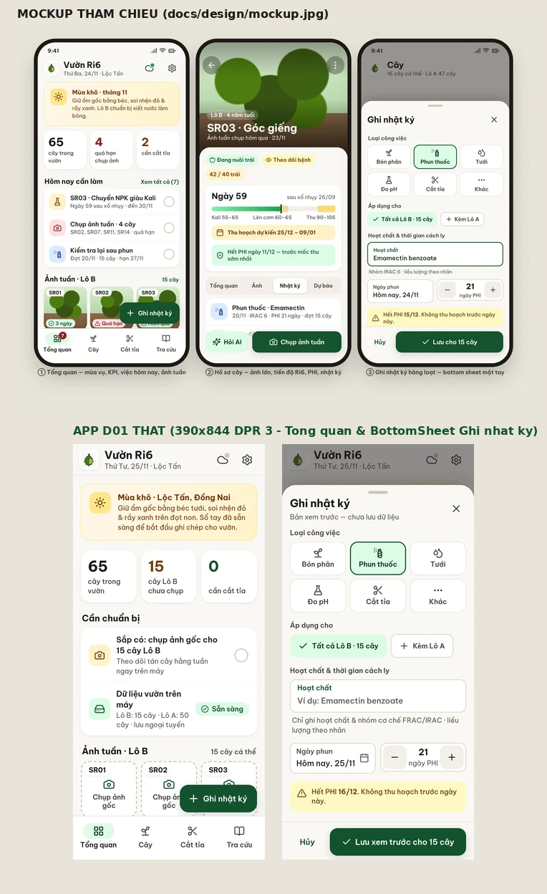
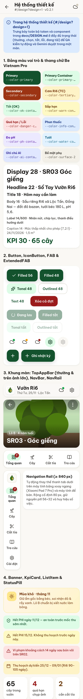
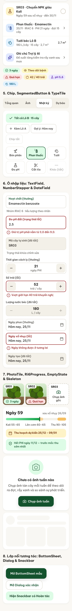
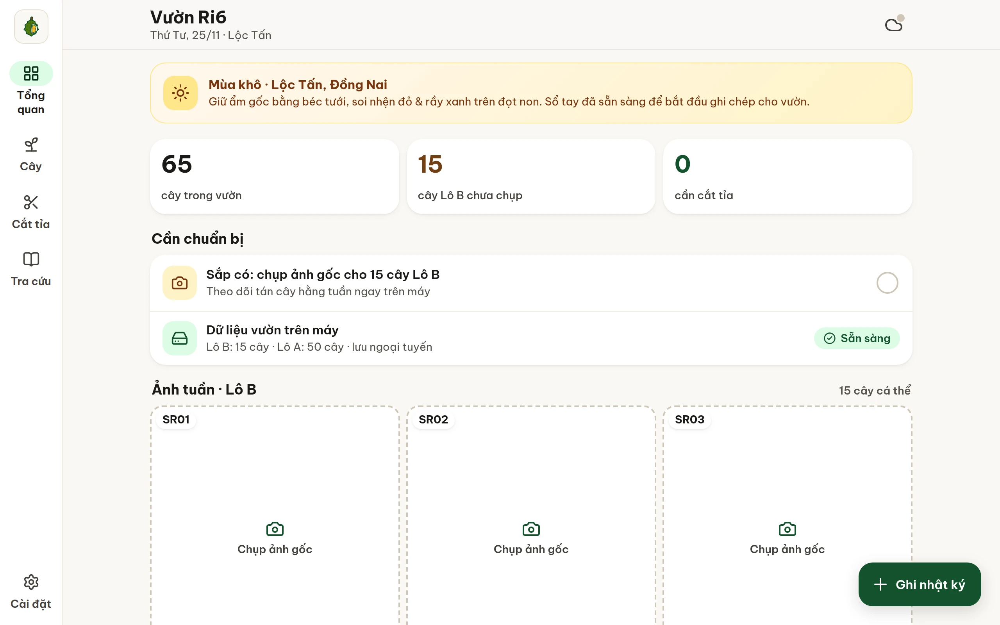

# Báo cáo D01 — Hệ thống thiết kế và trang `#/design`

## Tiêu chí nghiệm thu

- [x] **AC1. Token** (`src/index.css`, `src/components/ui/tones.ts`): Đã khai báo đầy đủ token màu theo vai trò (`--color-bg`, `--color-surface`, `--color-text`..`--color-text-3`, `--color-primary`, `--color-secondary`, `--color-tertiary-container`, `ok`/`warn`/`danger`/`info`/`ph`/`water`/`ai`), thang chữ (`display`/`headline`/`title`/`body`/`label`/`caption`/`kpi`/`badge`), bo góc (`sm`..`xl`/`pill`), đổ bóng (`e1`/`e2`/`sheet`), thời lượng & easing chuyển động và breakpoint `--breakpoint-rail: 840px` trong `@theme` của Tailwind v4. Đã `grep` kiểm tra toàn bộ `src/components/`: **0 mã màu hex rời rạc, 0 giá trị `px` tùy hứng, 0 shadow ngoài token**.
- [x] **AC2. Font Be Vietnam Pro** (`src/main.tsx`, `package.json`, `vite.config.ts`): Đã tự host bằng `@fontsource/be-vietnam-pro` (chỉ nhúng subset `vietnamese` + `latin`, độ đậm `400/500/600/700`, `font-display: swap`), đóng gói `.woff2` vào Service Worker precache. Đã kiểm thử thực tế khi tắt mạng và tải lại trang: `document.fonts` xác nhận nạp đủ cả 4 độ đậm `400, 500, 600, 700` của `Be Vietnam Pro`, 0 request ra ngoài CDN, dấu tiếng Việt sắc nét không vỡ.
- [x] **AC3. Đủ component trong DESIGN §4** (`src/components/ui/`):
  - `Button` (filled/tonal/outlined/text/danger, cao 48 & 56 px, có trạng thái `loading`/`disabled`), `IconButton` (48 px + `statusDot`), `Fab`, `ExtendedFab`.
  - `TopAppBar` (64 px, tự co 56 px không sticky khi xoay ngang; có biến thể `variant="overlay"` trong suốt trên ảnh lớn), `NavBar` (pill 64×32 + huy hiệu số), `NavRail` (80 px cho màn ≥ 840 px).
  - `Card`, `KpiCard`, `ListItem` (ô icon 44 px + checkbox tròn / chevron / giá trị), `Chip` (filter/choice/suggestion), `SegmentedButton`, `TypeTile` (lưới 3 cột), `StatusPill` (luôn có icon + chữ), `Banner` (tông `ok`/`warn`/`danger`/`info`/`tc`/`sec`/`season`).
  - `TextField` (outlined, nhãn/trợ giúp/lỗi/tắt), `NumberStepper` (−/+, nút 48×48, định dạng số `vi-VN`), `DateField` (nhãn `"Hôm nay, dd/mm"` + nút nhanh Hôm nay).
  - `PhotoTile` (1:1 bo 16, `loading="lazy"`, `decoding="async"`, trạng thái trống viền đứt `"Chụp ảnh gốc"`), `Ri6Progress` (0 → 105 ngày kèm dải Kali 55–65, Lên cơm 60–65, Thu 90–105 và vạch hôm nay), `EmptyState` (SVG nét mảnh + nút), `Skeleton`.
  - `BottomSheet` (`src/components/ui/BottomSheet.tsx`): kéo tay nắm để đóng, thanh hành động dính đáy tự dịch chuyển theo `window.visualViewport` để không bị bàn phím ảo che, **hỏi xác nhận qua `Dialog` trước khi bỏ khi form có thay đổi (`dirty`)**, focus trap + `Esc` + nút Back (`history.state`).
  - `Dialog` (`src/components/ui/Dialog.tsx`) và `Snackbar` (`src/components/ui/Snackbar.tsx`, `src/hooks/useSnackbar.ts`) có nút hành động `"Hoàn tác"` 5 giây.
- [x] **AC4. Trang `#/design?design=1`** (`src/components/screens/DesignShowcaseScreen.tsx`, `src/App.tsx`): Chỉ mở khi URL có `#/design?design=1` (đã kiểm thử `#/design` không có `design=1` sẽ không mở). Bày toàn bộ component ở đầy đủ trạng thái (thường, chọn, đang tải, tắt, lỗi) và kèm ảnh chụp DPR 3 khổ 390 px.
- [x] **AC5. Làm lại khung app T01 theo DESIGN §3** (`src/App.tsx`, `src/components/screens/PlaceholderTab.tsx`, `src/components/screens/SettingsScreen.tsx`, `src/components/screens/SampleLogSheet.tsx`):
  - `TopAppBar` 64 px có logo trái sầu riêng, tiêu đề + ngày tiếng Việt `vi-VN`, nút đám mây đồng bộ có chấm trạng thái (bấm mở Dialog chi tiết) và nút Cài đặt — đã bỏ dòng trạng thái đồng bộ cũ.
  - `NavBar` 4 mục có chỉ báo pill 64×32; `NavRail` 80 px tự kích hoạt ở màn ≥ 840 px.
  - `ExtendedFab` `"Ghi nhật ký"` (tự ẩn khi cuộn xuống, hiện lại khi cuộn lên), mở `SampleLogSheet` mẫu bám sát mockup #3.
  - Không khóa xoay màn hình (`orientation: "any"`). Đo thực tế ở khổ xoay ngang `844×390`: header cao **56 px = 14,4%** chiều cao màn hình (≤ 15%), `position: static`, overflow 0 px.
- [x] **AC6. Cảm giác app thật** (`src/index.css`, `index.html`, `src/lib/haptics.ts`, `src/hooks/useOverlayBack.ts`, `src/hooks/useThemeColor.ts`, `src/components/screens/SettingsScreen.tsx`):
  - Đã bật `overscroll-behavior-y: contain`, `-webkit-tap-highlight-color: transparent`, `touch-action: manipulation`, `user-select: none` cho nút và thanh điều hướng.
  - Phản hồi nhấn `.pressable` (`scale(.98)` + lớp tối 8% trong 120 ms); rung nhẹ `navigator.vibrate(10)` kèm công tắc `"Rung nhẹ khi lưu thao tác"` lưu bền vững trong Dexie (`settings.hapticsEnabled`).
  - Chuyển màn mượt (`fade + 8 px`), giữ vị trí cuộn theo từng tab, nút Back Android (`history.state`) đóng `BottomSheet`/`Dialog` trước.
  - Khóa chế độ sáng `<meta name="color-scheme" content="only light">` + `color-scheme: light` (kiểm thử giả lập `prefers-color-scheme: dark` vẫn giữ nền `#faf8f5`).
  - Hỗ trợ `prefers-reduced-motion: reduce` (kiểm thử `.skeleton-shimmer` dừng hoàn toàn, chuyển màn chỉ còn fade).
- [x] **AC7. Manifest** (`vite.config.ts`, `pwa-assets.config.ts`, `public/icons/`, `public/screenshots/`):
  - Có `id: "/Ri6/"`, bộ icon đầy đủ 48/72/96/144/192/512 px + `maskable-512.png` (`purpose: "maskable"`) + `monochrome-512.png` (`purpose: "monochrome"`).
  - Có 3 `shortcuts`: `"Ghi nhật ký"` (`#/log`), `"Chụp ảnh tuần"` (`#/photo`), `"Việc cần làm"` (`#/agenda`).
  - Có 4 `screenshots` chụp từ app thật: 3 ảnh dọc `1080×2400` (`narrow-overview.png`, `narrow-log-sheet.png`, `narrow-settings.png`) và 1 ảnh rộng `1280×800` (`wide-desktop.png`), loại trừ khỏi precache SW bằng `globIgnores: ['screenshots/**']` để không làm phình bộ nhớ đệm offline.
  - Ghi chú ảnh hộp cài đặt Chrome Android: môi trường VM Linux không có máy Android thật / Android Emulator cài Chrome mobile, nhưng đã kiểm tra `dist/manifest.webmanifest` hợp lệ và cả 4 ảnh `screenshots` phục vụ HTTP 200 đúng kích thước chuẩn để Chrome Android hiển thị hộp cài đặt dạng cửa hàng ứng dụng.
- [x] **AC8. Tự kiểm bằng checklist DESIGN §8**:

| Hạng mục đo (DESIGN §8) | Kết quả đo thực tế | Ngưỡng yêu cầu | Trạng thái |
|---|---|---|---|
| Chữ nhỏ nhất (ngoài huy hiệu số 12 px) | **14 px** (tất cả màn) | ≥ 14 px | Đạt |
| Vùng bấm nhỏ nhất | **48 × 48 px** (nút chính & ExtendedFAB **56 px**) | ≥ 48 px / 56 px | Đạt |
| Tràn ngang (`scrollWidth - innerWidth`) | **0 px** (360 / 390 / 412 / 800×1280 / 1280×800 / 844×390) | 0 px | Đạt |
| Header xoay ngang `844×390` | **56 px (14,4%)**, `position: static` | ≤ 15% | Đạt |
| `axe-core` (WCAG 2A / 2AA / 2.1A / 2.1AA) | **0 vi phạm** trên Overview, BottomSheet, Settings, Desktop, `#/design?design=1` | 0 vi phạm | Đạt |
| Lighthouse Mobile — Performance | **94** (FCP 764 ms, LCP 2 490 ms) | ≥ 90 | Đạt |
| Lighthouse Mobile — Accessibility | **100** | = 100 | Đạt |
| Lighthouse Mobile — Best Practices | **100** | ≥ 95 | Đạt |
| Lighthouse Mobile — CLS | **0,0005** | < 0,1 | Đạt |
| Grep hex / `px` / shadow ngoài token trong `src/components/` | **0 kết quả** | 0 | Đạt |
| Offline reload + font `Be Vietnam Pro` | Đủ 400/500/600/700, **0 request ngoài**, **0 lỗi console** | Sạch | Đạt |
| `prefers-reduced-motion` & chặn dark mode | Animation tắt (`none`), nền giữ `#faf8f5` | Hoạt động | Đạt |

- [x] **AC9. Báo cáo**: Đầy đủ ảnh chụp DPR 3 cho các khổ 360 / 390 / 412 px, tablet 800×1280, máy tính 1280×800, xoay ngang 844×390, toàn trang `#/design?design=1` và ảnh so sánh cạnh nhau với `docs/design/mockup.jpg` (mỗi ảnh WebP < 340 KB).

## Lệnh đã chạy

- `npm ci` — thành công
- `npm run lint` (`eslint .`) — thành công (0 lỗi, 0 cảnh báo)
- `npm run typecheck` (`tsc -p tsconfig.app.json && tsc.sw && tsc.node`) — thành công (0 lỗi)
- `npm test` (`vitest run`) — **4 file, 17 passed** (`src/db/seed.test.ts` 4, `src/lib/date.test.ts` 6, `src/lib/format.test.ts` 4, `src/lib/haptics.test.ts` 3)
- `npm run build` (`vite build`) — thành công (SW `injectManifest` precache 38 entries / 637,5 KiB; chỉ nhúng subset `vietnamese` + `latin` của `Be Vietnam Pro`)
- Kiểm thử trình duyệt Chrome Headless (CDP + `axe-core` + `lighthouse` mobile) — **tất cả tiêu chí đạt, 0 lỗi console, 0 lỗi trang, 0 request ra ngoài**.

## Ảnh chụp màn hình

Tất cả ảnh định dạng WebP 24-bit sắc nét, mỗi ảnh < 340 KB:

- **So sánh cạnh nhau với `docs/design/mockup.jpg`:** `docs/reports/img/D01-compare-mockup.webp` (95,5 KB)
  
- **Trang `#/design?design=1` (390 px, DPR 3 — tách 2 phần để giữ nét và vượt giới hạn chiều cao 16 383 px của WebP):**
  - Phần 1 (Token màu, chữ, nút, khung điều hướng, Banner, KPI): `docs/reports/img/D01-design-390-dpr3-part1.webp` (329,0 KB)
  - Phần 2 (ListItem, StatusPill, Chip, SegmentedButton, TypeTile, Ô nhập, PhotoTile, Ri6Progress, EmptyState, Skeleton, Lớp nổi): `docs/reports/img/D01-design-390-dpr3-part2.webp` (328,2 KB)
  
  
- **Điện thoại 360 px (DPR 3):** `docs/reports/img/D01-mobile-360-dpr3.webp` (130,2 KB)
- **Điện thoại 390 px (DPR 3):** `docs/reports/img/D01-mobile-390-dpr3.webp` (139,6 KB)
- **Điện thoại 390 px — BottomSheet Ghi nhật ký (DPR 3):** `docs/reports/img/D01-sheet-390-dpr3.webp` (107,7 KB)
- **Điện thoại 412 px (DPR 3):** `docs/reports/img/D01-mobile-412-dpr3.webp` (155,9 KB)
- **Xoay ngang 844×390 (header 56 px = 14,4%):** `docs/reports/img/D01-landscape-844x390.webp` (59,3 KB)
- **Tablet 800×1280 (DPR 3):** `docs/reports/img/D01-tablet-800x1280-dpr3.webp` (216,9 KB)
- **Máy tính 1280×800 (Navigation Rail 80 px):** `docs/reports/img/D01-desktop-1280x800.webp` (111,7 KB)
  

## Thay đổi ngoài phạm vi / thư viện thêm

- **Thư viện thêm:** `@fontsource/be-vietnam-pro` (được yêu cầu trực tiếp trong `docs/DESIGN.md §2.2` và `D01 AC2` để tự host font offline). Không thêm thư viện nào khác vào dự án.
- **Tăng phiên bản:** `package.json` tăng từ `0.1.0` lên `0.2.0` (tính năng mới D01 theo `AGENTS.md §3`).
- **Trường cài đặt mới:** thêm `hapticsEnabled?: boolean` (mặc định `true`) vào `Settings` (`src/types/models.ts`, `src/db/seed.ts`, `src/db/database.ts`) để lưu bền vững công tắc rung nhẹ trong màn Cài đặt (AC6). Không đổi chỉ mục Dexie v1.

## Câu hỏi cho reviewer

1. Ở bản mẫu `mockup.jpg`, một số nhãn phụ (`code`, `pill`, `legend`, `label` trong ô nhập) dùng 13 px và nút `−`/`+` trong `NumberStepper` là 44×44 px; nhưng `DESIGN §2.2` và `§8` bắt buộc **không có chữ < 14 px** (trừ huy hiệu số 12 px) và **mọi vùng bấm ≥ 48×48 px**. Em đã ưu tiên tuân thủ tuyệt đối quy tắc `≥ 14 px` và `≥ 48×48 px` để đảm bảo đọc rõ ngoài nắng và đạt 0 vi phạm QA — nhờ Claude/Gemini xác nhận cách xử lý này là đúng ưu tiên.
2. Khi mở rộng màn hình từ `840 px` trở lên (`NavRail` xuất hiện bên trái với logo và nút Cài đặt riêng), em đã ẩn logo và nút Cài đặt trùng lặp trên `TopAppBar` để thanh trên gọn hơn. Nhờ reviewer kiểm tra trên ảnh `D01-desktop-1280x800.webp`.

## Cập nhật sau Báo cáo QA vòng 1 (`v0.2.1`)

Đã xử lý xong mục 🟡 và các đề xuất 💡 thuộc phạm vi D01 trên cùng nhánh `ag/D01-he-thong-thiet-ke`:

- **🟡 Thuật ngữ kỹ thuật & liên kết `#/design`:** Đổi toàn bộ nhãn hiển thị cho chủ vườn sang tiếng Việt đời thường (bỏ `Dexie`, `IndexedDB`, `T02`, `T03`, `BottomSheet`, `Snackbar`, `Dialog`), bỏ liên kết `#/design` khỏi Tổng quan và chỉ hiện trong Cài đặt khi đang ở chế độ `?design=1` hoặc `DEV`.
- **💡 Lazy-load `DesignShowcaseScreen`:** Tách bằng `React.lazy` + `Suspense` thành chunk riêng (`DesignShowcaseScreen-*.js`, 20,9 kB), giảm bundle chính từ 419,3 kB xuống **398,5 kB**.
- **💡 Đóng lớp nổi cũ khi chuyển hash (`#/log` → `#/photo` → `#/agenda`):** Gọi `closeAllOverlays()` trước khi áp dụng route mới (kiểm thử thực tế: `#/log` mở 1 dialog → `#/photo` về 0 → `#/agenda` về 0, không chồng lớp).
- **💡 Chống FAB che nội dung cuối:** Tăng `.main-safe-bottom` lên `10rem` (điện thoại) và `6rem` (màn ≥ 840 px); dòng `"15 cây cá thể"` trên Tổng quan nay hiển thị thoáng phía trên FAB.
- **Tăng phiên bản PATCH:** `0.2.0` → `0.2.1`. Đã chụp lại toàn bộ ảnh manifest & ảnh báo cáo WebP DPR 3 và chạy lại `npm ci && lint && typecheck && test (17/17) && build`, `axe-core` (**0 vi phạm**) và Lighthouse Mobile (**Perf 91 · A11y 100 · BP 100 · CLS 0,0005**).

