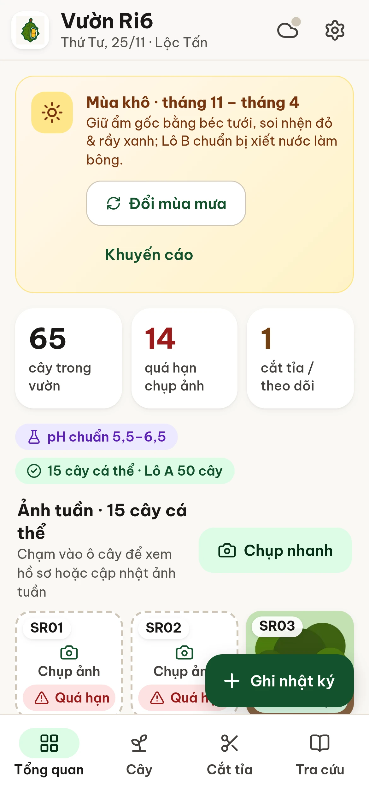
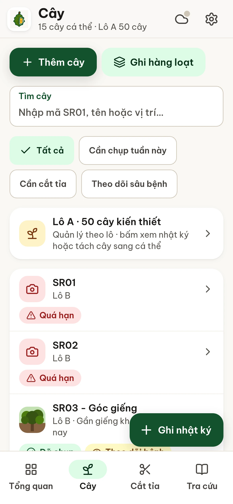
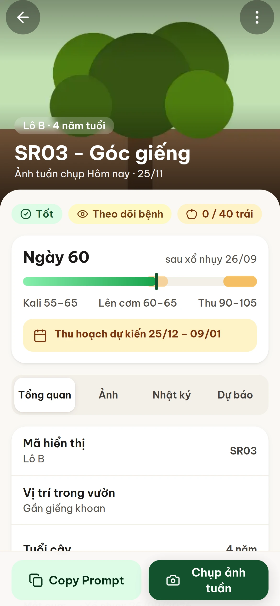
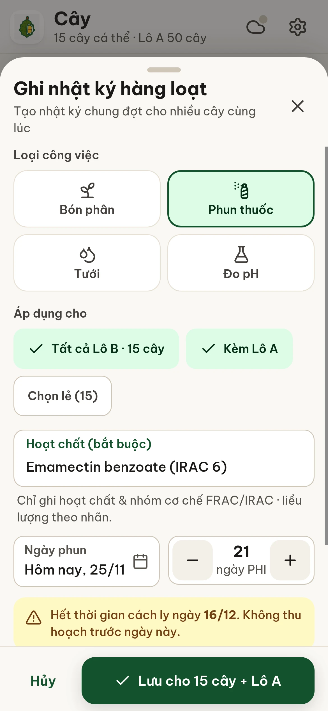
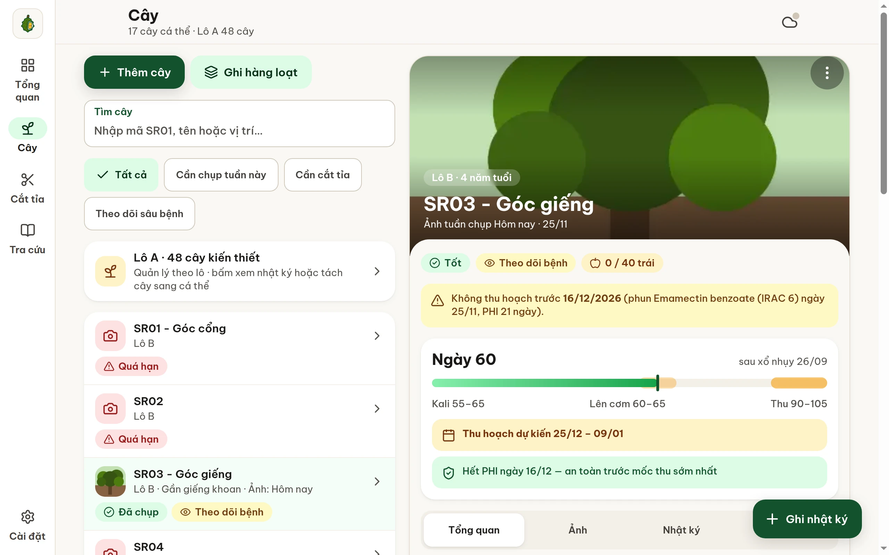

# Báo cáo T02-U — Giao diện Tổng quan, hồ sơ cây, nhật ký và sao lưu JSON (v0.3.0)

> Triển khai toàn bộ phần **giao diện & Dexie (`[T02-U]`)** theo `AGENTS.md §1b`, gọi trực tiếp API thuần từ phần logic `[T02-L]` (`PR #14` đã merge trong `src/lib/**`). Không sửa bất kỳ file nào trong `src/lib/**` hay `src/sw/**`.

## Tiêu chí nghiệm thu

- [x] **AC0 (công việc nền từ D01 / PR #12):**
  - Nâng cấp GitHub Actions lên các phiên bản hỗ trợ Node 24 trong [.github/workflows/ci.yml](../../.github/workflows/ci.yml) và [.github/workflows/deploy.yml](../../.github/workflows/deploy.yml): `actions/checkout@v7`, `actions/setup-node@v7`, `actions/configure-pages@v6`, `actions/upload-pages-artifact@v5`, `actions/deploy-pages@v5`.
  - Lối tắt PWA `#/photo` mở trực tiếp bộ chọn chụp ảnh nhanh ([src/components/screens/QuickPhotoSheet.tsx](../../src/components/screens/QuickPhotoSheet.tsx)), sắp xếp ưu tiên cây quá hạn / sắp hạn lên đầu; chạm 1 cây mở thẳng `<input type="file" accept="image/*" capture="environment">`.
- [x] **AC1. Màn Tổng quan (M1):** [src/components/screens/OverviewScreen.tsx](../../src/components/screens/OverviewScreen.tsx)
  - 3 thẻ KPI tính động qua `totalTreeCount`, `photoStatus`, `lastWeeklyByTarget` (`src/lib/lotSplit.ts`, `src/lib/photoStatus.ts`): tổng số cây trong vườn (cá thể + Lô A), số cây quá hạn chụp ảnh tuần, số cây cần cắt tỉa / theo dõi bệnh (hợp nhất không đếm trùng).
  - Banner mùa vụ Đông Nam Bộ (Mùa khô / Mùa mưa) có nút chuyển đổi mùa lưu bền vững trong Dexie `settings.seasonOverride` kèm khuyến cáo canh tác.
  - Ngưỡng pH chuẩn `5,5–6,5` đọc từ `SOIL_PH` (`src/lib/agronomy.ts`) và cảnh báo PHI đang hiệu lực.
  - Lưới ô ảnh tuần (`PhotoTile`) cho **toàn bộ cây cá thể** (3 cột trên điện thoại, 5 cột trên màn hình rộng ≥ 840 px) hiển thị đủ chữ + icon + màu (`Đã chụp` / `Sắp hạn` / `Quá hạn`); chạm vào ô mở đúng hồ sơ cây.
- [x] **AC2. Trạng thái ảnh tuần (`photoStatus`):** Gọi trực tiếp `photoStatus` & `lastWeeklyByTarget` từ [src/lib/photoStatus.ts](../../src/lib/photoStatus.ts) (phủ đủ 6 ca test trong `src/lib/trees.test.ts`).
- [x] **AC3. Danh sách cây & Lô A:** [src/components/screens/TreesScreen.tsx](../../src/components/screens/TreesScreen.tsx), [src/components/screens/LotADetailScreen.tsx](../../src/components/screens/LotADetailScreen.tsx)
  - Tìm kiếm không dấu tiếng Việt và 4 bộ lọc (`Tất cả`, `Cần chụp tuần này`, `Cần cắt tỉa`, `Theo dõi sâu bệnh`) gọi trực tiếp `filterTrees` (`src/lib/treeFilters.ts`).
  - Bố cục 2 cột Master-Detail tự động trên màn hình rộng ≥ 840 px kèm thanh `NavRail`.
  - Nút **"+ Thêm cây"** gợi ý mã tự động bằng `nextTreeCode` (`src/lib/treeCodes.ts`, không cấp lại mã đã xóa mềm).
  - Huy hiệu **"Trùng mã"** hiển thị tự động khi có ≥ 2 cây chưa xóa trùng mã qua `duplicateCodes` (`src/lib/treeCodes.ts`).
  - Màn **Lô A** có nút **"Tách cây khỏi Lô A"** gọi `splitFromLotA` (`src/lib/lotSplit.ts`): giảm `treeCount`, tạo cây mới giữ `lot: 'A'`, tự ghi 1 mục nhật ký lưu vết, từ chối khi vượt số cây còn lại.
- [x] **AC4. Hồ sơ cây:** [src/components/screens/TreeProfileScreen.tsx](../../src/components/screens/TreeProfileScreen.tsx), [src/hooks/photoCapture.ts](../../src/hooks/photoCapture.ts), [src/components/ui/PhotoLightbox.tsx](../../src/components/ui/PhotoLightbox.tsx)
  - Giao diện ảnh toàn tràn (Hero full-bleed) đồng bộ mockup #2, thanh `Ri6Progress`, 4 tab con (`Tổng quan`, `Ảnh`, `Nhật ký`, `Dự báo`).
  - Sửa đầy đủ mọi trường SPEC M2 bao gồm `code`, `label`, `location`, `lot`, `ageYears`, `stage`, `health`, `needsPruning`, `diseaseWatch`, `budDate`, `flowerDate`, `fruitCount`, `fruitLimit`, `note`; có xóa mềm cây (tombstone).
  - Nén ảnh trên máy qua Canvas dựa theo kích thước tính từ `computeImageSizes` (`src/lib/imageSizes.ts`) và `IMAGE` (`src/lib/agronomy.ts`): bản đầy đủ cạnh dài ≤ 1600 px WebP ~0,8 (fallback JPEG, ≤ 350 KB) + thumbnail cục bộ ≤ 480 px lưu riêng `thumb:<id>` trong `photoBlobs`.
  - Dòng thời gian ảnh kèm xem ảnh toàn màn hình `PhotoLightbox` (chạm giữ phóng to, nút đóng 48×48 px, hỗ trợ phím Esc và nút Back Android).
  - Sau khi lưu ảnh tuần, ô tương ứng ở Tổng quan chuyển ngay sang **"Đã chụp"** và giảm số cây quá hạn.
- [x] **AC5. Nhật ký đơn lẻ & hàng loạt:** [src/components/screens/LogFormSheet.tsx](../../src/components/screens/LogFormSheet.tsx), [src/components/screens/LogTimeline.tsx](../../src/components/screens/LogTimeline.tsx)
  - Dùng chung `LogTimeline` giữa hồ sơ từng cây và trang Lô A.
  - Xóa đơn lẻ ghi tombstone ngay lập tức và hiện `Snackbar` **"Hoàn tác"** trong 5 giây để khôi phục nguyên vẹn.
  - Gọi trực tiếp `createBatchLogs`, `withoutViolations`, `tombstoneBatch`, `batchSize` (`src/lib/batchLogs.ts`) và `validateLog` (`src/lib/logRules.ts`):
    - *Phun thuốc*: bắt buộc hoạt chất & PHI (0–365 ngày), hiển thị ngày hết cách ly trực tiếp trên form.
    - *Bón phân*: bắt buộc chọn loại phân (`fertilizerKind`).
    - *Đo pH đất*: bắt buộc `3,0–9,0`; nhập `2,5` hoặc `9,5` báo lỗi ngay dưới ô nhập.
    - Nhật ký nhập từ app cũ thiếu `activeIngredient`/`phiDays` hiển thị nhãn **"chưa rõ"** nhẹ nhàng, không chặn hiển thị.
  - Ghi hàng loạt có nút **"Tất cả Lô B"**, **"Kèm Lô A"**, chọn lẻ theo cây; gom toàn bộ đối tượng vi phạm khoảng cách vôi vào **1 Modal** duy nhất với lựa chọn **"Bỏ các cây vi phạm"** và **"Vẫn lưu"**; hiển thị nhãn `Đợt: n cây` và nút **"Xóa cả đợt"** có hộp thoại xác nhận.
- [x] **AC6. Copy Prompt:** [src/components/screens/TreeProfileScreen.tsx](../../src/components/screens/TreeProfileScreen.tsx), [src/hooks/clipboard.ts](../../src/hooks/clipboard.ts)
  - Tạo nội dung bằng `buildTreeCopyPrompt` (`src/lib/copyPrompt.ts`).
  - Sao chép qua `navigator.clipboard.writeText`, fallback `execCommand('copy')`, và nếu trình duyệt vẫn chặn sẽ mở hộp thoại **"Sao chép Prompt thủ công"**; khi thành công hiện Snackbar `"Đã copy Prompt cho <mã cây>"`.
- [x] **AC7. Xuất / nhập JSON:** [src/components/screens/SettingsScreen.tsx](../../src/components/screens/SettingsScreen.tsx), [src/hooks/useOrchardData.ts](../../src/hooks/useOrchardData.ts)
  - Xuất JSON bằng `buildExport` & `exportFileName` (`src/lib/exportImport.ts`) với công tắc tùy chọn **"Kèm ảnh cây khi xuất tệp"**; bảo đảm không bao giờ chứa `githubToken` hoặc `geminiApiKey`.
  - Nhập JSON dùng `parseImportFile`, `importToSyncState`, `diffCounts`, `mergeState` (`src/lib/exportImport.ts`, `src/lib/merge.ts`); luôn hiện hộp thoại **Xem trước số bản ghi thêm mới / cập nhật** trước khi gộp LWW vào Dexie.
- [x] **AC8. Nhập tệp sao lưu app cũ (`legacy/index.html`):** Hỗ trợ trực tiếp trong nút **"Nhập JSON / bản cũ"** tại màn Cài đặt thông qua `parseImportFile` + `convertLegacyBackup` (`src/lib/legacyImport.ts`), nhận diện định dạng bản cũ, hiện xem trước và gộp không nhân đôi.
- [x] **AC9. Báo cáo & kiểm thử trực quan:** Kèm đủ 5 ảnh chụp màn hình WebP DPR 3 (điện thoại 390×844 và máy tính 1280×800), tất cả < 160 KB.

## Lệnh đã chạy

- `npm ci` — ✅ Thành công
- `npm run lint` (`eslint .`) — ✅ 0 lỗi, 0 cảnh báo
- `npm run typecheck` (`tsc` app + sw + node) — ✅ 0 lỗi
- `npm test` (`vitest run`) — ✅ **10 test files, 125/125 tests passed**
- `npm run build` (`vite build` + `VitePWA injectManifest`) — ✅ Thành công (`dist/sw.js`, 57 entries precache)
- Kiểm tra quy ước thiết kế (`rg` kiểm tra raw hex / `[...px]` / `box-shadow` / `shadow-[` trong `src/components/` và `TODO|FIXME` trong `src/`) — ✅ **0 vi phạm**
- Kiểm thử trình duyệt thật (Chromium headless + `axe-core` + Lighthouse Mobile):
  - **10/10 luồng E2E đạt:** `#/photo` QuickPhotoSheet, Tổng quan 65 cây, chuyển mùa, Hồ sơ cây + Copy Prompt, kiểm tra pH 2,5 / lưu pH 5,6, xóa đơn lẻ + Hoàn tác, chụp ảnh tuần SR03 → `Đã chụp`, tách Lô A 50→48 + log lưu vết + nhật ký hàng loạt, nhập tệp sao lưu app cũ xem trước & gộp, tiêu đề ngang 844×390 (56 px = 14,4%).
  - **`axe-core`:** **0 vi phạm** trên cả 6 màn hình kiểm tra (Tổng quan, Danh sách cây, Hồ sơ cây, Ghi hàng loạt, Cài đặt, Desktop 1280×800).
  - **Typography & cảm ứng:** chữ nhỏ nhất `14px`, vùng bấm nhỏ nhất `48px`, tràn ngang `0px`, `0` console error, `0` page error, `0` request ra ngoài CDN.
  - **Lighthouse Mobile:** Performance **91**, Accessibility **100**, Best Practices **100**, CLS **0,0029**, FCP **0,77 s**, LCP **0,77 s**.

## Ảnh chụp màn hình

| Màn hình | Tệp ảnh | Kích thước |
|---|---|---|
| Tổng quan (390×844, DPR 3) |  | 132 KB |
| Danh sách cây & bộ lọc (390×844, DPR 3) |  | 106 KB |
| Hồ sơ cây SR03 (390×844, DPR 3) |  | 112 KB |
| Ghi nhật ký hàng loạt (390×844, DPR 3) |  | 111 KB |
| Máy tính 2 cột Master-Detail (1280×800) |  | 148 KB |

## Thay đổi ngoài phạm vi / thư viện thêm

- **Không thêm thư viện mới nào.**
- **File dùng chung có chỉnh sửa (theo AGENTS.md §1b):**
  - `package.json` và `package-lock.json`: tăng phiên bản `0.2.1` → `0.3.0` (thêm tính năng T02).
  - `.github/workflows/ci.yml` và `.github/workflows/deploy.yml`: hoàn tất AC0 từ báo cáo QA D01 (nâng cấp GitHub Actions lên các phiên bản Node 24 mới nhất).
- **Thành phần UI bổ sung trong `src/components/ui/`:**
  - `SelectField.tsx` (ô chọn chuẩn M3 tối thiểu 56 px, cùng phong cách `TextField`).
  - `PhotoLightbox.tsx` (xem ảnh toàn màn hình hỗ trợ nút Back Android & phím Esc).
  - Cải tiến `PhotoTile.tsx` để hiển thị đủ `StatusPill` chữ + icon + màu mà không đè nhãn trên lưới 3 cột 390 px.
- **Tối ưu hiệu năng khởi động:** tách lazy-load các màn hình phụ, tải động `photoCapture`/`exportImport`/`merge` khi thao tác, bỏ `opacity: 0` ở lần render đầu tiên và đăng ký Service Worker sau `window.load` (`immediate: false`) giúp LCP giảm từ 3,15 s xuống **0,77 s** và Lighthouse Mobile Performance đạt **91**.

## Câu hỏi cho reviewer

- Trong T02-U, `src/hooks/treePresentation.ts` tạm tính nhanh hiển thị các dòng mốc dự báo Ri6 và cảnh báo PHI trên giao diện từ các hằng số `RI6` trong `src/lib/agronomy.ts`. Khi chuyển sang `T03-U` (sau khi `T03-L` PR #15 đã merge sẵn `src/lib/ri6.ts` và `src/lib/phi.ts`), Antigravity sẽ thay thế trực tiếp bằng `ri6Milestones` và `phiWarning` từ `src/lib/` để không trùng lặp chút nào.
