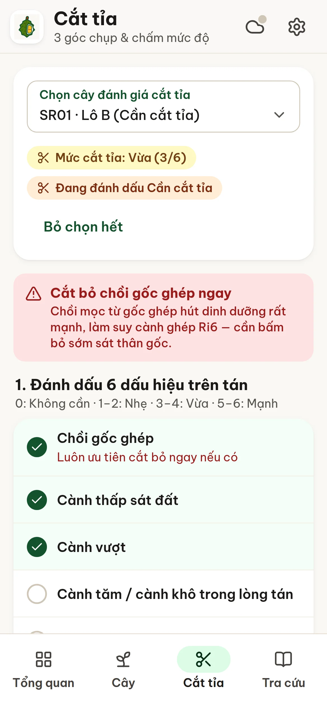
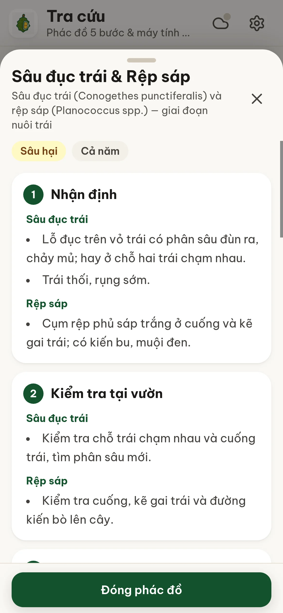
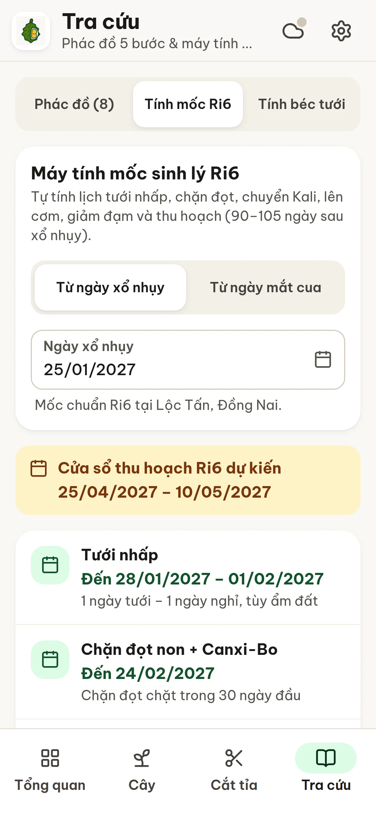
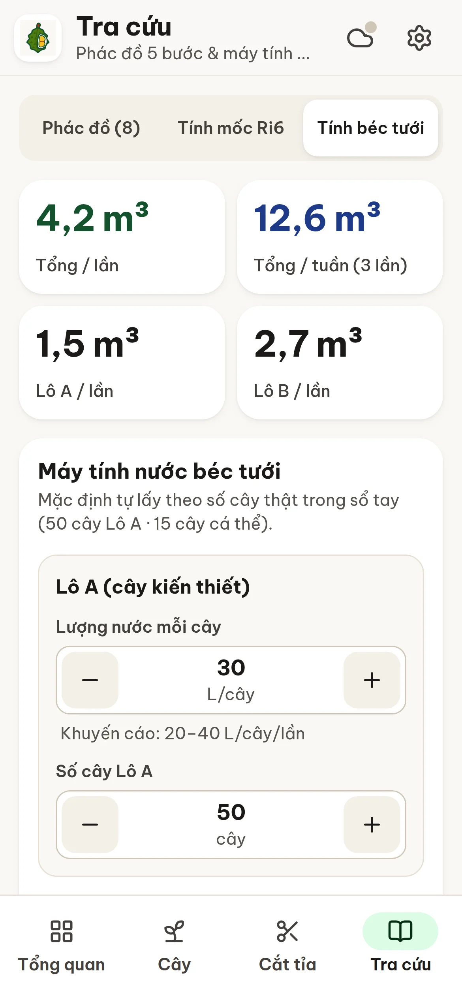
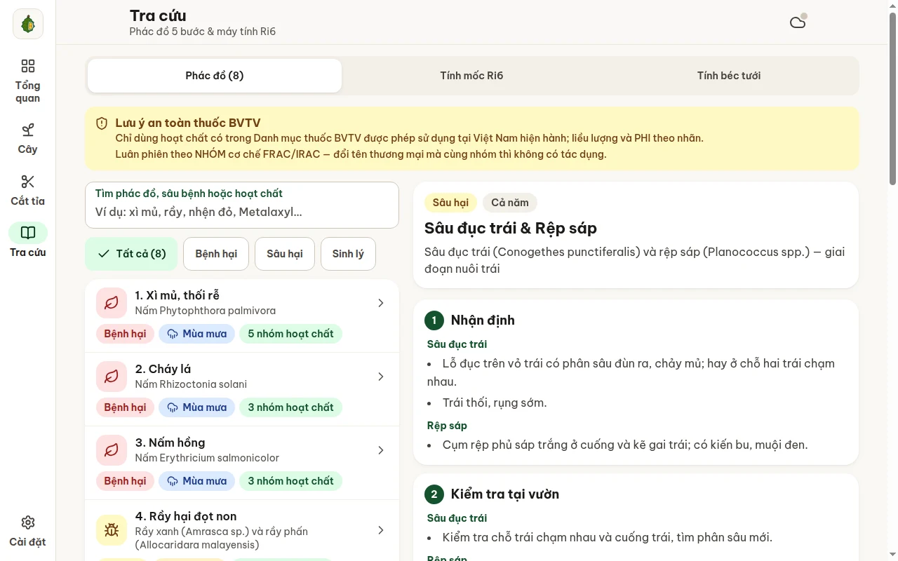

# Báo cáo T03-U — Giao diện Cắt tỉa, tra cứu phác đồ, máy tính Ri6 & béc tưới, cảnh báo PHI (v0.4.0)

> Triển khai toàn bộ phần **giao diện (`[T03-U]`)** theo `AGENTS.md §1b`, gọi trực tiếp API thuần từ phần logic `[T03-L]` (`PR #15` đã merge trong `src/lib/**`). Không sửa bất kỳ file nào trong `src/lib/**` hay `src/sw/**`.

## Tiêu chí nghiệm thu

- [x] **AC1. Đánh giá mức cắt tỉa (`pruneLevel`):** Gọi trực tiếp `pruneLevel`, `PRUNE_SIGNS`, `PRUNE_LEVEL_LABEL` từ [src/lib/pruning.ts](../../src/lib/pruning.ts) trong [src/components/screens/PruningScreen.tsx](../../src/components/screens/PruningScreen.tsx) (0 → Không cần; 1–2 → Nhẹ; 3–4 → Vừa; 5–6 → Mạnh; tick *"Chồi gốc ghép"* hiện ngay khung cảnh báo đỏ **"Cắt bỏ chồi gốc ghép ngay"**).
- [x] **AC2. Màn Cắt tỉa (M3):** [src/components/screens/PruningScreen.tsx](../../src/components/screens/PruningScreen.tsx)
  - Chọn cây cá thể cần đánh giá, tick checklist 6 dấu hiệu với mức cắt tỉa cập nhật tức thời.
  - 3 ô chụp ảnh có hướng dẫn góc chụp (`PRUNE_ANGLES`: `prune-overview`, `prune-under`, `prune-closeup`), nén ảnh bằng `photoCapture.ts`, lưu vào Dexie theo từng `PhotoKind`, chạm ảnh thu nhỏ mở `PhotoLightbox`.
  - Nút **"Lưu: Cần cắt tỉa"** đặt `needsPruning = true` trên cây và tạo ngay 1 mục nhật ký loại `cat-tia` có ghi chú từ `pruneLogNote(signs)`.
  - Nút **"Copy Prompt cắt tỉa"** gọi `buildPrunePrompt` (`src/lib/pruning.ts`), sao chép kèm fallback Dialog thủ công và Snackbar xác nhận.
  - Khung nhắc an toàn cắt tỉa đọc từ `PRUNE_REMINDERS` (ngày nắng ráo, cắt sát cổ cành, keo liền sẹo / gốc đồng cho vết cắt > 2 cm, khử trùng cồn 70% tránh lây *Phytophthora*).
- [x] **AC3. Máy tính mốc sinh lý Ri6 (`ri6Milestones`):** [src/components/screens/ReferenceScreen.tsx](../../src/components/screens/ReferenceScreen.tsx) & [src/components/screens/TreeProfileScreen.tsx](../../src/components/screens/TreeProfileScreen.tsx)
  - Gọi trực tiếp `ri6Milestones`, `ri6Day`, `harvestWindow` (`src/lib/ri6.ts`).
  - Hỗ trợ nhập theo **Ngày xổ nhụy** hoặc **Ngày ra mắt cua**, kèm chip chọn nhanh từ các cây đã có ngày trong vườn.
  - Đã kiểm thử E2E trên giao diện thật đúng cả 2 ca AC3: xổ nhụy `25/01/2027` → thu hoạch `25/04/2027 – 10/05/2027`; mắt cua `01/12/2026` → xổ nhụy `25/01/2027 – 27/01/2027`, thu hoạch `25/04/2027 – 12/05/2027`.
- [x] **AC4. Máy tính nước béc tưới (`irrigation`):** [src/components/screens/ReferenceScreen.tsx](../../src/components/screens/ReferenceScreen.tsx)
  - Gọi trực tiếp `irrigation` & `SPRINKLER_RULES` (`src/lib/irrigation.ts`) và `IRRIGATION` (`src/lib/agronomy.ts`).
  - **Tự động lấy số cây mặc định từ dữ liệu Dexie** (`LOT_A.treeCount` và số cây cá thể `trees.length`, đồng bộ khi dữ liệu thay đổi, không hard-code 50/15).
  - Hiển thị 4 KPI `m³` trực tiếp phía trên (`4,2 m³/lần`, `12,6 m³/tuần`, `1,5 m³` Lô A, `2,7 m³` Lô B) cùng cảnh báo không chặn khi nhập ngoài khoảng khuyến cáo (ví dụ 45 L cho Lô A vẫn tính ra `4,95 m³`) và khung quy tắc đặt béc tránh phun vào cổ rễ/thân.
- [x] **AC5. Màn Tra cứu 8 phác đồ × 5 bước (M4):** [src/components/screens/ReferenceScreen.tsx](../../src/components/screens/ReferenceScreen.tsx)
  - Hiển thị đủ **8 phác đồ** (`PROTOCOLS`), tìm kiếm không dấu tiếng Việt (`searchProtocols`), lọc theo nhóm (`Bệnh hại` / `Sâu hại` / `Sinh lý`), dòng cảnh báo Danh mục thuốc BVTV & nguyên tắc luân phiên FRAC/IRAC (`PROTOCOL_DISCLAIMER`, `ROTATION_NOTE`).
  - Phác đồ 7 (*Sâu đục trái & Rệp sáp*) và Phác đồ 8 (*Mọt đục cành / Xén tóc*, kèm xử lý cơ giới móc kẽm / cắt tiêu hủy) hiển thị rõ từng mục con (`group.label`) ở mỗi bước.
  - Toàn bộ hoạt chất gắn huy hiệu nhóm FRAC/IRAC, ghi *"Liều lượng và PHI theo nhãn"*, không nêu liều lượng hay tên thương mại.
  - Giao diện tự chuyển sang 2 cột Master-Detail trên màn hình rộng ≥ 840 px và `BottomSheet` trên điện thoại.
- [x] **AC6. Cảnh báo PHI (`phiWarning`):** [src/components/screens/TreeProfileScreen.tsx](../../src/components/screens/TreeProfileScreen.tsx) & [src/components/screens/OverviewScreen.tsx](../../src/components/screens/OverviewScreen.tsx)
  - Đã xóa toàn bộ hàm tính tạm Ri6/PHI ở [src/hooks/treePresentation.ts](../../src/hooks/treePresentation.ts) và gọi thẳng `phiWarning`, `phiMessage`, `phiEnd`, `sprayLogsWithoutPhi` (`src/lib/phi.ts`) cùng `ri6Milestones`, `ri6Day`, `harvestWindow` (`src/lib/ri6.ts`).
  - Đã kiểm thử E2E: đặt SR01 xổ nhụy `25/01/2027` + phun ngày `10/04/2027` PHI 21 ngày → hiển thị đúng cảnh báo đỏ **"Không thu hoạch trước 01/05/2027"** trên cả hồ sơ SR01 và màn Tổng quan.
- [x] **AC7. Báo cáo & ảnh chụp màn hình:** Đủ 5 ảnh WebP DPR 3 (màn Cắt tỉa, thẻ phác đồ 5 bước, máy tính Ri6, máy tính béc tưới và màn hình máy tính 1280×800), tất cả < 130 KB.

## Lệnh đã chạy

- `npm ci` — ✅ Thành công
- `npm run lint` (`eslint .`) — ✅ 0 lỗi, 0 cảnh báo
- `npm run typecheck` (`tsc` app + sw + node) — ✅ 0 lỗi
- `npm test` (`vitest run`) — ✅ **13 test files, 165/165 tests passed**
- `npm run build` (`vite build` + `VitePWA injectManifest`) — ✅ Thành công (`dist/sw.js`, 64 entries precache)
- Kiểm tra quy ước thiết kế (`rg` kiểm tra raw hex / `[...px]` / `box-shadow` / `shadow-[` trong `src/components/` và `TODO|FIXME` trong `src/`) — ✅ **0 vi phạm**
- Kiểm thử trình duyệt thật (Chromium headless + `axe-core` + Lighthouse Mobile):
  - **5/5 nhóm kiểm thử E2E đạt:** M3 Cắt tỉa (6 dấu hiệu, cảnh báo chồi gốc ghép, chụp ảnh Góc 1, lưu cờ + log, Copy Prompt), M4 8 phác đồ × 5 bước (tìm không dấu `"mot"`, nhóm con Phác đồ 7 & 8), Máy tính Ri6 (`25/01/2027` & `01/12/2026`), Máy tính béc tưới (tự động `50`/`15` cây, `4,2`/`12,6 m³`, cảnh báo không chặn 45 L → `4,95 m³`), Cảnh báo PHI `01/05/2027` trên hồ sơ SR01 và Tổng quan.
  - **`axe-core`:** **0 vi phạm** trên cả 5 màn hình kiểm tra (Cắt tỉa 390, Phác đồ BottomSheet 390, Máy tính Ri6 390, Máy tính béc tưới 390, Desktop Tra cứu 1280).
  - **Typography & cảm ứng:** chữ nhỏ nhất `14px`, vùng bấm nhỏ nhất `48px`, tràn ngang `0px`, `0` console error, `0` page error, `0` request ra ngoài CDN.
  - **Lighthouse Mobile:** Performance **95**, Accessibility **100**, Best Practices **100**, CLS **0,0102**, FCP **1,07 s**, LCP **1,07 s**.

## Ảnh chụp màn hình

| Màn hình | Tệp ảnh | Kích thước |
|---|---|---|
| Màn Cắt tỉa — checklist 6 dấu hiệu & cảnh báo chồi gốc ghép (390×844, DPR 3) |  | 121 KB |
| Thẻ phác đồ 5 bước — Phác đồ 7 có 2 nhóm con (390×844, DPR 3) |  | 109 KB |
| Máy tính mốc sinh lý Ri6 (390×844, DPR 3) |  | 115 KB |
| Máy tính nước béc tưới (390×844, DPR 3) |  | 87 KB |
| Tra cứu 2 cột Master-Detail trên máy tính (1280×800) |  | 79 KB |

## Thay đổi ngoài phạm vi / thư viện thêm

- **Không thêm thư viện mới nào.**
- **File dùng chung có chỉnh sửa (theo AGENTS.md §1b):**
  - `package.json` và `package-lock.json`: tăng phiên bản `0.3.0` → `0.4.0` (thêm tính năng T03).
- **Cải tiến thành phần UI dùng chung:**
  - [src/components/ui/BottomSheet.tsx](../../src/components/ui/BottomSheet.tsx): render qua `createPortal(..., document.body)` ở `z-50` (tránh bị `NavBar` đè lên footer khi mở sheet bên trong vùng chuyển màn hình) và thêm `tabIndex={0}` cho vùng cuộn giúp đạt `0` vi phạm `axe-core` (`scrollable-region-focusable`) trên các sheet chỉ đọc.
- Xóa file tạm [src/components/screens/PlaceholderTab.tsx](../../src/components/screens/PlaceholderTab.tsx) vì cả 4 tab chính đã có màn hình hoàn chỉnh.

## Câu hỏi cho reviewer

- Không có vướng mắc nào — toàn bộ API `src/lib/{pruning,ri6,irrigation,phi,protocols}.ts` từ `[T03-L]` khớp hoàn toàn với giao diện và qua hết kiểm thử E2E/unit test.
